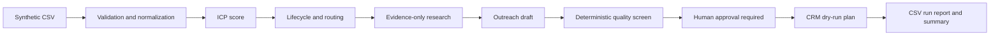

# Portfolio project — synthetic GTM revenue engine

## Business problem

Teams need repeatable lead qualification, routing, research, and review before
CRM operations or outreach. This project demonstrates those steps using
synthetic records and deterministic rules.

## Architecture and data flow

## Engineering and limitations

The capstone uses stable file paths, bounded input validation, mock-first
integration patterns, offline tests, explicit failure reasons, and a review
boundary. It does not send messages or write to HubSpot. Ollama, n8n import,
and CRM credentials remain optional local setup steps. Synthetic outputs are
test metrics, not customer results.

## Resume project description

Built a Python-based synthetic GTM revenue-engine demo that validates and
normalizes leads, applies explainable qualification and routing, produces
evidence-constrained research and outreach drafts, screens copy deterministically,
and generates a dry-run CRM plan with human approval. Added offline unit tests,
operational reporting, a FastAPI webhook example, and Windows-ready setup docs.
